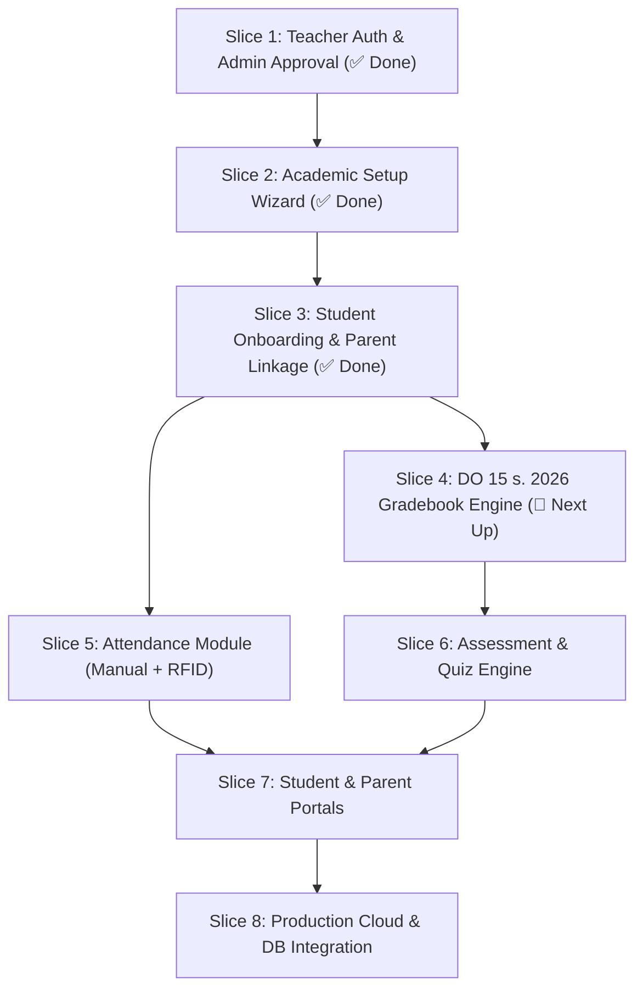

# ClassRealm — Step-by-Step Feature Slices Roadmap

> **System:** ClassRealm (DepEd Senior High School Integrated Management System)  
> **Grading Standard:** DepEd Order No. 15, s. 2026 (Strengthened SHS Curriculum)  
> **Architecture:** Flutter Web & Mobile + Firebase Auth + Supabase PostgreSQL  
> **Document Date:** September 2026  

---

## 🗺️ High-Level Slices Overview

---

## 📌 Feature Slices Breakdown

### 🟢 SLICE 1: Teacher Auth, Onboarding & Security (COMPLETED)
*Layunin: Secure at DepEd-compliant na pagpaparehistro ng guro, admin vetting, at initial security lifecycle.*

* [x] **1.1 Teacher Registration Form**
  * Hati-hating pangalan: First Name, Middle Name (optional), Last Name.
  * Date Picker: Modern wheel/grid selector na sumusunod sa `YYYY-MM-DD` (18+ age validation).
  * Malinis na label: "Email Address" (tinanggal ang contact number field alinsunod sa request).
  * Informational Temp Password Notice: `{lastname_lower}{YYYYMMDD}`.
* [x] **1.2 Admin Approval Portal**
  * Tinanggal ang lahat ng mock data; tanging mga totoong nag-register ang lilitaw.
  * Admin review modal: Approve / Reject.
  * Pag-approve: Account status $\rightarrow$ `pendingFirstLogin`, dialog displaying the generated temp password.
* [x] **1.3 First-Time Login & Password Reset**
  * Login gamit ang temp password $\rightarrow$ deretso sa forced password change.
  * Password strength rules at real-time validation.
  * Animated Celebratory Modal pagkatapos magpalit ng password $\rightarrow$ Status $\rightarrow$ `active`.
* [x] **1.4 Demo Quick-Login Preserved**
  * Napanatili ang Admin, Teacher, Student, at Parent chips sa Login Screen para sa panel demo at prototype presentation.
* [x] **1.5 Backend & API Readiness**
  * `EmailVerificationService` abstraction + `HttpEmailVerificationService` template para sa future email deliverability API.
  * `DatabaseConfig` class para sa hybrid Firebase Auth at Supabase PostgreSQL setup.

---

### 🟢 SLICE 2: Academic Setup Wizard (COMPLETED)
*Layunin: Post-login wizard kung saan pipiliin ng bagong guro ang kanyang hawakang academic level, track, subjects, at sections bago pumasok sa dashboard.*

* [x] **2.1 S.Y. & Semester Selection**
  * School Year (e.g., `2026-2027`) at Term/Semester (`1st Semester` / 3 Terms).
* [x] **2.2 Grade Level Selection**
  * Toggle sa pagitan ng `Grade 11` at `Grade 12`.
* [x] **2.3 DepEd Category & Cluster Hierarchy (DO 15, s. 2026)**
  * Cascading Dropdowns:
    * **Category:** *SSHS - CORE*, *SSHS - ACADEMIC*, *SSHS - TECH-PRO*, *SSHS - ARTS & SPORTS*.
    * **Cluster:** (e.g. *STEM*, *ABM*, *HUMSS*, *ICT*, *Industrial Arts*).
    * **Subject:** (e.g. *General Mathematics*, *Effective Communication*, *Computer Programming Java*).
* [x] **2.4 Automated DepEd Grading Weights**
  * Awtomatikong naglo-load ng official weights (hal. Core: 20% WW - 50% PT - 30% EX; TechPro: 15% WW - 65% PT - 20% EX).
  * May toggle para sa *"Custom Grading Weight Override"* kung may special institutional rules.
* [x] **2.5 Section Creation & Management**
  * Magdagdag ng sections (e.g., `Grade 11 - Einstein`, `Grade 11 - Newton`).
* [x] **2.6 Wizard Confirmation & State Save**
  * I-save sa `teacher_profiles` at `subject_catalog` $\rightarrow$ Dadalhin si Teacher sa kanyang newly configured Teacher Dashboard.

---

### 🟢 SLICE 3: Student Onboarding, Masterlist & Parent Linkage (COMPLETED)
*Layunin: Pagpapatala ng mga estudyante at awtomatikong pag-link sa kanilang mga magulang.*

* [x] **3.1 Student Masterlist Entry**
  * Single Manual Add o Bulk CSV/Excel Upload.
  * Fields: LRN (12 digits strictly unique), First, Middle, Last, Gender, Birthday.
* [x] **3.2 Automatic Student Account Generation**
  * Username: `{first_name} {last_name}`
  * Temp Password: `{lastname_lower}{YYYYMMDD}`
* [x] **3.3 Parent Account Auto-Creation & Linkage**
  * Parent Name, Contact Number (`09XXXXXXXXX`), Relationship (`Mother`/`Father`/`Guardian`).
  * Naka-link 1:1 o 1:Many sa student LRN.
* [x] **3.4 LRN Deduplication System**
  * Bina-block ang pag-duplicate ng LRN sa buong school database.

---

### 🟡 SLICE 4: DepEd DO 15, s. 2026 Automated E-Class Record (Gradebook Engine) (NEXT UP 🚀)
*Layunin: 100% eksaktong computational engine na nakabase sa official Excel template nang walang manual error.*

* [ ] **4.1 Written Works (WW) Sheet**
  * 10 item score columns, Highest Possible Score (HPS), Total, Percentage Score (PS), Weighted Score (WS).
* [ ] **4.2 Performance Tasks (PT) Sheet**
  * 10 item score columns, HPS, Total, PS, WS.
* [ ] **4.3 Quarterly Examination (EX) Sheet**
  * Sub-components: ST1 (30%), ST2 (30%), Term Exam (40%). HPS, PS, WS.
* [ ] **4.4 Initial Grade & 41-Tier Transmutation Table**
  * Full 41-tier transmutation (e.g. 74.00–75.99 $\rightarrow$ 75; 98.40–99.99 $\rightarrow$ 99; 100 $\rightarrow$ 100).
  * Auto-generation ng Descriptors (*Outstanding*, *Very Satisfactory*, etc.) at Remarks (*Passed* / *Failed*).
* [ ] **4.5 3-Term Final Averaging**
  * $\text{Final Grade} = \frac{\text{Term 1} + \text{Term 2} + \text{Term 3}}{3}$.
* [ ] **4.6 DepEd Forms Preview & Export**
  * School Form 9 (SF9 / Learner Progress Report Card) at SF10 preview.

---

### ⚪ SLICE 5: Attendance Module (Manual + RFID)
*Layunin: Daily presence tracking na may hardware sync.*

* [ ] **5.1 Teacher Manual Attendance Matrix**
  * Present, Late, Absent, Excused tags na may summary per month.
* [ ] **5.2 RFID ESP32 Hardware Integration**
  * Hardware tap-in sync gamit ang offline SQLite buffer.
* [ ] **5.3 Real-Time Notifications**
  * Push/SMS alerts sa mga magulang kapag nag-tap in o out ang estudyante.

---

### ⚪ SLICE 6: Assessment & Quiz/Exam Creation Engine
*Layunin: Paperless assessments na awtomatikong pumapasok sa gradebook.*

* [ ] **6.1 Teacher Quiz/Exam Builder**
  * Multiple Choice, Identification, True/False, at Problem Solving.
* [ ] **6.2 Anti-Cheat Protocol**
  * Tab-switching detection, fullscreen mode, at countdown timers.
* [ ] **6.3 Auto-Sync to E-Class Record**
  * Ang scores ng quiz/exam ay awtomatikong pumapasok sa WW o EX columns ng estudyante.

---

### ⚪ SLICE 7: Student & Parent Mobile Portals
*Layunin: Transparency at communication para sa mga mag-aaral at magulang.*

* [ ] **7.1 Student Mobile App View**
  * Real-time grades, schedule, pending assignments, at attendance report.
* [ ] **7.2 Parent Mobile App View**
  * Real-time notification sa attendance ng anak, quarterly report card viewing.

---

### ⚪ SLICE 8: Production Cloud & Database Wiring (Supabase + Firebase)
*Layunin: Paglipat mula sa local mock service patungo sa cloud production.*

* [ ] **8.1 Live Firebase Authentication**
  * Pagpapagana ng live Firebase SDK gamit ang real project credentials.
* [ ] **8.2 Supabase PostgreSQL Migration**
  * Pag-execute ng 3NF tables mula sa `Database_plan.md` at pag-enable ng Row Level Security (RLS).
* [ ] **8.3 Live Email Checker API Integration**
  * Paglagay ng live API key sa `HttpEmailVerificationService` para sa deliverability checks.
