# End-to-End System Flow: Performance Tasks (PT) & Written Works (WW / Activities)
## Complete Dual-Method Architecture: Online & In-Person

This document specifies the unbroken end-to-end data flow, multi-layer validation, database persistence, Supabase storage handling, and Gradebook synchronization for **Performance Tasks (PT)** and **Written Works (WW / Activities)** across the Class Realm application.

---

## 1. Core Business & Grading Rules

1. **Section Isolation**: All classwork items are strictly bound to `subject_offering_id`. Only students enrolled in that specific subject offering can view or submit to the task.
2. **Gradebook Slot & Capacity**:
   - Written Works (WW): 10 slots per term (`WW 1` to `WW 10`, `category = 'ww'`).
   - Performance Tasks (PT): 10 slots per term (`PT 1` to `PT 10`, `category = 'pt'`).
   - Slot conflict detection: A slot cannot be used by more than one active classwork item in the same term and section.
3. **Highest Possible Score (HPS)**:
   - **Strictly 1 to 100** ($1 \le \text{HPS} \le 100$).
   - **Bawal ang 0** (HPS cannot be 0).
   - **Bawal lumampas sa 100** (HPS cannot exceed 100).
4. **Student Earned Score**:
   - **0 to HPS** ($0 \le \text{Score} \le \text{HPS}$).
   - A student can receive 0 if they failed, submitted empty work, or missed the requirement, but they cannot receive negative points or points higher than the item's HPS.
5. **File Attachment Restrictions (Online Mode)**:
   - File types: `.pdf`, `.doc`, `.docx` only.
   - Max file size: `15 MB` (15,728,640 bytes).
6. **Text Constraints**:
   - Title: 2 to 100 characters.
   - Instructions / Rubric: 1 to 30,000 characters.

---

## 2. Complete End-to-End Flowchart

```mermaid
flowchart TD
    %% Teacher Creation
    subgraph PHASE_1["PHASE 1: TEACHER CREATION & GRADEBOOK SETUP"]
        T1["Teacher: Click '+ Create PT' or '+ Create Activity'"] --> T2["Select Mode: Online or In-Person"]
        T2 --> T3["Fill Title (2-100), Instructions (max 30k), HPS (1-100), Term & Slot (1-10)"]
        T3 --> T4{"Online Mode?"}
        T4 -- Yes --> T5["Optional: Attach Material (PDF/DOC/DOCX <= 15MB)"]
        T4 -- No --> T6["In-Person Mode (No file upload needed)"]
        T5 --> T7["Client-side Validation (Validators.validateClasswork*)"]
        T6 --> T7
        T7 --> T8["Upload Material to Supabase Storage: classwork-materials"]
        T8 --> T9["Insert Record into DB: classwork_items"]
        T9 --> T10["Sync HPS Header to DB: gradebook_term_sheets.hps[category][slot] = HPS"]
    end

    %% Student Access & Submission
    subgraph PHASE_2["PHASE 2: STUDENT DISCOVERY & SUBMISSION"]
        T10 -. Section Isolated Query .-> S1["Student Feed: Query where subject_offering_id matches enrollment"]
        S1 --> S2{"Check Completion Mode"}
        
        %% Online Student Flow
        S2 -- "Online Mode" --> SO1["Student views instructions & clicks 'Open Material'"]
        SO1 --> SO2["Student clicks 'Submit Work' (StudentSubmitWorkDialog)"]
        SO2 --> SO3["Attach Work File (PDF/DOC/DOCX <= 15MB)"]
        SO3 --> SO4["Client-side Validation (File type & 15MB size check)"]
        SO4 --> SO5["Upload to Storage: classwork-materials/submissions/..."]
        SO5 --> SO6["Insert/Update DB: student_classwork_submissions (status = 'submitted')"]
        SO6 --> SO7["Insert Attachment Metadata: submission_attachments"]

        %% In-Person Student Flow
        S2 -- "In-Person Mode" --> SIP1["Student views purple In-Person Banner in feed"]
        SIP1 --> SIP2["Student submits physical paper/project in class to Teacher"]
    end

    %% Teacher Review & Grading
    subgraph PHASE_3["PHASE 3: TEACHER REVIEW & SCORING"]
        SO7 --> TR1["Teacher opens ActivitySubmissionsScreen"]
        SIP2 --> TR1
        TR1 --> TR2{"Completion Mode"}

        %% Online Review
        TR2 -- "Online" --> TRO1["Teacher sees 'Open File' badge (PDF / DOC)"]
        TRO1 --> TRO2["Teacher clicks 'Open File' -> url_launcher opens document in browser/app"]
        TRO2 --> TRO3["Teacher evaluates work & inputs Score (0 <= Score <= HPS) + Feedback"]

        %% In-Person Review
        TR2 -- "In-Person" --> TRIP1["Teacher sees 'Physical Submission' badge"]
        TRIP1 --> TRIP2["Teacher toggles Status: 'Submitted' or 'Missing'"]
        TRIP2 --> TRIP3["Teacher inputs Score (0 <= Score <= HPS) + Feedback"]

        %% Validation & Persistence
        TRO3 --> TRV["Client Validation: 0 <= Score <= HPS"]
        TRIP3 --> TRV
        TRV --> TRP["Update DB: student_classwork_submissions (status = 'graded', score = score)"]
    end

    %% Gradebook Sync
    subgraph PHASE_4["PHASE 4: GRADEBOOK TWO-WAY SYNCHRONIZATION"]
        TRP --> GB1["Fetch Current Term Sheet: gradebook_term_sheets"]
        GB1 --> GB2["Write Cell: scores[studentId][categoryKey][slotIndex] = score"]
        GB2 --> GB3["Persist Term Sheet to DB via SubjectRepository.saveGradebookTermSheet"]
        GB3 --> GB4["Auto-recalculate Total Scores & DepEd Weighted Percentage"]
        GB4 --> FIN["Student & Parent Portal: View graded score, status & feedback in real-time"]
    end
```



---

## 3. Database Schema & Supabase Mapping

### 1. `classwork_items`
| Column | Type | Constraints / Details |
| :--- | :--- | :--- |
| `id` | `uuid` | Primary Key |
| `subject_offering_id` | `uuid` | Foreign key to `subject_offerings.id` (enforces section isolation) |
| `title` | `text` | Max 100 characters |
| `instructions` | `text` | Max 30,000 characters |
| `type` | `text` | `'performance_task'` (PT) or `'activity'` (WW) |
| `completion_mode` | `text` | `'online'` or `'in_person'` |
| `term_number` | `int` | `1`, `2`, or `3` (Quarter/Term) |
| `gradebook_column_index`| `int` | `1` to `10` (Slot index in Gradebook) |
| `max_score` | `numeric` | **Strictly 1 to 100 (HPS)** |
| `deadline` | `timestamptz` | Due date and time |
| `storage_path` | `text` | Relative path in `classwork-materials` bucket (optional) |
| `attachment_name` | `text` | Original file name (optional) |
| `file_size_bytes` | `bigint` | Max 15,728,640 bytes (15 MB) |
| `mime_type` | `text` | PDF or MS Word mime types |

### 2. `student_classwork_submissions`
| Column | Type | Constraints / Details |
| :--- | :--- | :--- |
| `id` | `uuid` | Primary Key |
| `classwork_id` | `uuid` | Foreign key to `classwork_items.id` |
| `student_id` | `uuid` | Foreign key to `users.id` |
| `status` | `text` | `'missing'`, `'submitted'`, or `'graded'` |
| `score` | `numeric` | **0 to HPS** ($0 \le \text{Score} \le \text{HPS}$) |
| `feedback` | `text` | Optional teacher remarks / notes |
| `submitted_at` | `timestamptz` | Timestamp when student submitted (or marked by teacher) |
| `updated_at` | `timestamptz` | Last updated timestamp |

*Unique Constraint*: `(classwork_id, student_id)` — ensures exactly one active submission record per student per task.

### 3. `submission_attachments`
| Column | Type | Constraints / Details |
| :--- | :--- | :--- |
| `id` | `uuid` | Primary Key |
| `submission_id` | `uuid` | Foreign key to `student_classwork_submissions.id` |
| `file_name` | `text` | Name of the student's submitted file |
| `storage_url` | `text` | Storage path in bucket `classwork-materials` |
| `file_size_bytes` | `bigint` | File size (Max 15MB) |
| `mime_type` | `text` | `application/pdf`, `application/msword`, etc. |

### 4. `gradebook_term_sheets`
| Key Path | Structure | Description |
| :--- | :--- | :--- |
| `hps['pt'][colIndex]` | `number` | Highest Possible Score for Performance Task column ($1 \le \text{HPS} \le 100$) |
| `hps['ww'][colIndex]` | `number` | Highest Possible Score for Written Work column ($1 \le \text{HPS} \le 100$) |
| `scores[studentId]['pt'][colIndex]` | `number` | Earned score for student ($0 \le \text{Score} \le \text{HPS}$) |
| `scores[studentId]['ww'][colIndex]` | `number` | Earned score for student ($0 \le \text{Score} \le \text{HPS}$) |

---

## 4. Source Code File Reference

| Component | File Path |
| :--- | :--- |
| **Creation Dialog** | `lib/features/teacher/sub_features/assessments/screens/create_requirement_flow.dart` |
| **Teacher Review Screen** | `lib/features/teacher/sub_features/assessments/screens/activity_submissions_screen.dart` |
| **Student Classwork Card** | `lib/features/student/shared/widgets/student_classwork_card.dart` |
| **Student Submit Dialog** | `lib/features/student/shared/widgets/student_submit_work_dialog.dart` |
| **Classwork Repository** | `lib/data/repositories/supabase_teacher_classwork_repository.dart` |
| **Gradebook Repository** | `lib/data/repositories/subject_repository.dart` |
| **Validators & Constants** | `lib/core/utils/validators.dart` |

---

## 5. Instructions for Collaborator / Classmate

To pull and run these updates on another laptop:

```bash
# 1. Switch to the main branch
git checkout main

# 2. Pull the latest commits from origin
git pull origin main

# 3. Get dependencies
flutter pub get

# 4. Run the app
flutter run
```
