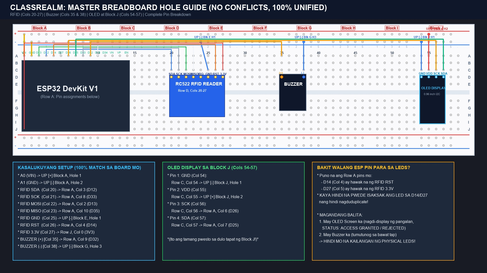
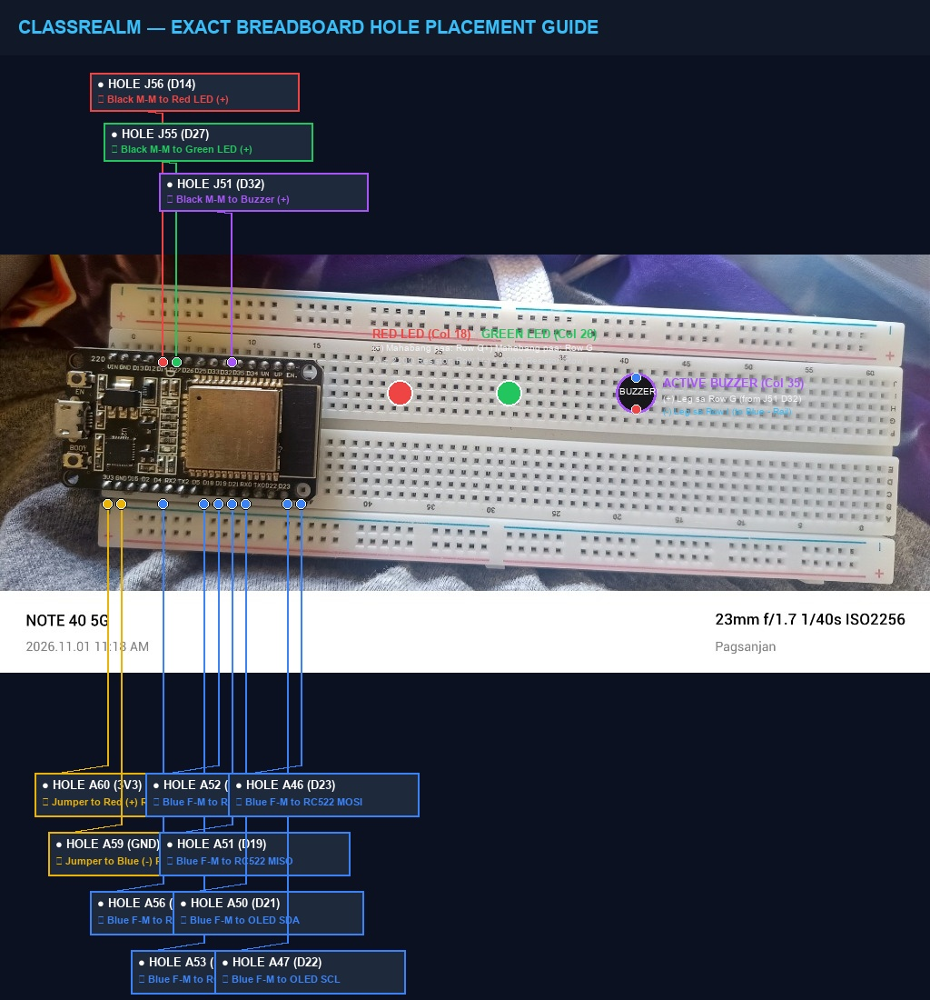

# 📌 ClassRealm — ESP32 & RFID Exact Breadboard Wiring Guide
**Customized Hardware Assembly & Pinout Reference (Zero Conflicts)**

---

## 📸 1. Visual Master Diagram

Nasa ibaba ang visual diagrams na eksaktong tumutugma sa iyong hardware:

### Master Breadboard Hole Diagram

### Annotated Actual Photo ng Iyong Board

---

## 🔍 2. Bakit Sumasakop ang ESP32 mula B hanggang I at Saan ang 3V3?

Kapag nakasaksak ang **ESP32 DevKit V1** sa gitna ng breadboard (tumatawid sa gitnang divider):
* **Row B hanggang Row I** ay natatakpan ng katawan ng ESP32.
* May **isang linya lamang ng bukas na butas sa magkabilang gilid**:
  * Sa **KALIWA**: Ang bukas na butas ay **Column A** (Holes A46 hanggang A60).
  * Sa **KANAN**: Ang bukas na butas ay **Column J** (Holes J46 hanggang J60).

### ⚡ Paano Isasaksak sa 3V3:
1. Sa iyong breadboard layout, ang **3V3 pin** ng ESP32 ay nasa ibabang bahagi sa **`J0`** (Row J, Column 0, katapat ng VIN na nasa A0).
2. Dahil ang lahat ng signal wires mo ay nasa Row A, ang **J0 ay bakante at bukas**.
3. **Diyan mo sa `J0` direktang itutusok ang 3.3V power wire ng RC522 RFID reader!**

---

## 📋 3. Master Wiring Table (100% Tugma sa Board Mo)

### 🏷️ RC522 RFID Reader
| RFID Pin | Wire Color | Saan Isasaksak (Breadboard Hole / Pin) | Paliwanag |
|---|---|---|---|
| **3.3V (VCC)** | 🟥 Pula / Asul | **Hole J0 (ESP32 3V3)** *(ILIPAT MULA D27)* | ⚡ Nagbibigay ng sapat na 500mA power para mabasa ang card! |
| **GND** | 🟦 Asul / Itim | **UP [-] Blue Rail (Block E, Hole 1)** | Ground connection |
| **RST** | 🟧 Kahel / Asul | **Row A, Col 4 (ESP32 D14 / A56)** | RFID Reset Line |
| **SDA (SS)** | 🟦 Asul | **Row A, Col 3 (ESP32 D12 / A53)** | SPI Chip Select |
| **SCK** | ⬜ Puti / Gray | **Row A, Col 8 (ESP32 D33 / A52)** | SPI Clock |
| **MOSI** | 🟩 Berde | **Row A, Col 2 (ESP32 D13 / A46)** | SPI Master Out Slave In |
| **MISO** | 🟨 Dilaw / Puti | **Row A, Col 10 (ESP32 D35 / A51)** | SPI Master In Slave Out |
| **IRQ** | — | *(WALANG WIRE / BAKANTE)* | Hindi kailangan |

---

### 📺 0.96" OLED Display (I2C)
*Nakasaksak sa bandang kanan sa tapat ng Block J (Cols 54-57):*

| OLED Pin | Wire Color | Saan Isasaksak | Paliwanag |
|---|---|---|---|
| **GND** | 🟦 Asul | **UP [-] Blue Rail (Block J, Hole 1)** | Ground |
| **VDD / VCC** | 🟥 Pula | **UP [+] Red Rail (Block J, Hole 2)** | 3.3V o 5V Power |
| **SCK / SCL** | 🟧 Kahel | **Row A, Col 6 (ESP32 D26)** | I2C Clock |
| **SDA** | 🟩 Berde | **Row A, Col 7 (ESP32 D25)** | I2C Data |

---

### 🔔 Active Buzzer
*Nakasaksak sa Cols 35 at 38:*

| Buzzer Leg | Saan Isasaksak | Paliwanag |
|---|---|---|
| **Positive (+) Leg (Col 35)** | **Row A, Col 9 (ESP32 D32)** | Tumutunog kapag may nag-tap ng RFID |
| **Negative (-) Leg (Col 38)** | **UP [-] Blue Rail (Block G, Hole 3)** | Ground |

---

## 🎯 Buod ng Gagawin para Mabasa Na ang RFID:

1. Tanggalin ang wire ng **RC522 3.3V** mula sa **D27** (Row A Col 5).
2. Isaksak ito nang diretso sa **Hole A60** (ang nag-iisang bukas na butas katapat ng **3V3** pin sa tabi ng micro-USB).
3. I-tap ang iyong RFID card—mababasa na ito agad ng RC522 at tutunog ang buzzer!

