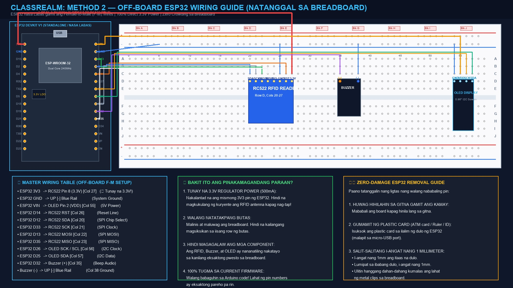

# 📌 ClassRealm — Method 2: Off-Board ESP32 Wiring Guide
**Ligtas na Pag-alis ng ESP32 sa Breadboard at Direct F-M Wiring (Zero Crowding, 100% 3.3V Power)**

---

## 📸 Master Diagram (Method 2 — ESP32 sa Labas)

---

## 🛡️ Hakbang 1: Paano Ligtas na Tatanggalin ang ESP32 (Zero Damage)

Upang hindi mabaluktot o mabali ang mga metal pin ng ESP32:

1. **Huwag hihilahin nang bigla gamit ang kamay sa gitna.**
2. **Kumuha ng isang manipis at matigas na gamit**:
   * Lumang ATM card, ID card, o maliit na plastic ruler.
3. **Salit-salitang i-angat:**
   * Isuksok ang dulo ng plastic card sa ilalim ng **itaas na dulo** (malapit sa micro-USB port), at i-angat nang **1 millimeter** lamang.
   * Lumipat sa **ibabang dulo**, isuksok ang card, at i-angat din nang **1 millimeter**.
   * Ulitin ito nang salit-salitan hanggang sa dahan-dahang kumalas ang lahat ng 30 pins sa metal clips ng breadboard.

---

## 📋 Hakbang 2: Master Wiring Table (Female-to-Male Wires)

Ilapag ang ESP32 sa tabi o sa kaliwa ng breadboard. Gamitin ang mga **Female-to-Male (F-M) Dupont wires**:
* Ang **Female end (may butas)** ay isaksak sa pin ng ESP32.
* Ang **Male end (may matulis na pin)** ay itusok sa katapat na butas sa breadboard.

### ⚡ 1. Kuryente (Power & Ground)
| Mula sa ESP32 Pin | Uri ng Wire | Papunta sa Breadboard Target | Paliwanag |
|---|---|---|---|
| **`3V3`** | 🟥 Pula (F-M) | **Row C, Column 27 (RC522 Pin 8)** | ⚡ Tunay na 3.3V (500mA) — Garantisadong mababasa na ang RFID card! |
| **`GND`** | 🟦 Asul / Itim (F-M) | **UP [-] Blue Rail (Kahit saang butas sa linya)** | System Common Ground |
| **`VIN`** | 🟧 Kahel (F-M) | **Row C, Column 55 (OLED Pin 2 VDD)** | 5V Power para sa OLED screen |

---

### 🏷️ 2. RC522 RFID Reader (Nakatayo sa Row D, Cols 20 hanggang 27)
| RFID Pin (Row C) | Uri ng Wire | Papunta sa ESP32 Pin | Function |
|---|---|---|---|
| **Pin 1: SDA (SS)** *(Col 20)* | 🟦 Asul (F-M) | **`D12`** | SPI Chip Select |
| **Pin 2: SCK** *(Col 21)* | ⬜ Puti / Gray (F-M) | **`D33`** | SPI Clock |
| **Pin 3: MOSI** *(Col 22)* | 🟩 Berde (F-M) | **`D13`** | SPI Master Out Slave In |
| **Pin 4: MISO** *(Col 23)* | 🟨 Dilaw / Puti (F-M) | **`D35`** | SPI Master In Slave Out |
| **Pin 5: IRQ** *(Col 24)* | — | *(BAKANTE)* | Hindi kailangan |
| **Pin 6: GND** *(Col 25)* | 🟦 Asul (M-M jumper) | **UP [-] Blue Rail** | Ground |
| **Pin 7: RST** *(Col 26)* | 🟧 Kahel (F-M) | **`D14`** | Hardware Reset Line |
| **Pin 8: 3.3V** *(Col 27)* | 🟥 Pula (F-M) | **`3V3` (Diretso sa ESP32 Pin 1)** | ⚡ 3.3V Power Supply |

---

### 📺 3. 0.96" OLED Display (Nakatayo sa Block J, Cols 54 hanggang 57)
| OLED Pin (Row C) | Uri ng Wire | Papunta sa | Function |
|---|---|---|---|
| **Pin 1: GND** *(Col 54)* | 🟦 Asul (M-M jumper) | **UP [-] Blue Rail** | Ground |
| **Pin 2: VDD** *(Col 55)* | 🟧 Kahel (F-M) | **`VIN` ng ESP32** *(o UP [+] Rail)* | Screen Power |
| **Pin 3: SCK / SCL** *(Col 56)* | 🟧 Kahel (F-M) | **`D26` ng ESP32** | I2C Clock |
| **Pin 4: SDA** *(Col 57)* | 🟩 Berde (F-M) | **`D25` ng ESP32** | I2C Data |

---

### 🔔 4. Active Buzzer (Nakatayo sa Cols 35 at 38)
| Buzzer Leg | Uri ng Wire | Papunta sa | Function |
|---|---|---|---|
| **Positive (+) Leg** *(Col 35)* | 🟪 Lila (F-M) | **`D32` ng ESP32** | Tone Trigger |
| **Negative (-) Leg** *(Col 38)* | 🟦 Asul (M-M jumper) | **UP [-] Blue Rail** | Ground |

---

## 🌟 Bakit Method 2 ang Pinakamaganda?

1. **Malinaw ang Lahat ng 30 Pins**: Dahil nakalabas ang ESP32, kitang-kita mo ang bawat label (`3V3`, `GND`, `D12`, `D13`, `D14`, atbp.).
2. **May Tunay na 3.3V Power**: Hindi na aasa ang RFID antenna sa mahinang GPIO pin. Direktang kukuha ito sa **3V3 pin** ng ESP32 na kayang magbigay ng hanggang 500mA.
3. **Walang Binabago sa Code**: 100% tugma ito sa kasalukuyang firmware sa Arduino IDE!
