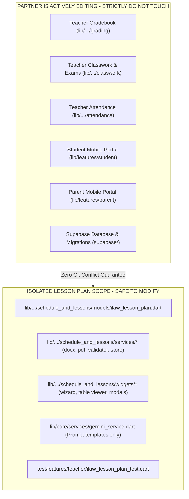

# DepEd 2026 3-Term ILAW Modified Lesson Plan Generator Redesign Plan

> **For agentic workers:** REQUIRED SUB-SKILL: Use `superpowers:subagent-driven-development` (recommended) or `superpowers:executing-plans` to implement this plan task-by-task. Steps use checkbox (`- [ ]`) syntax for tracking.

**Goal:** Enhance the ClassRealm Senior High School (SHS) lesson plan feature into an authentic **DepEd Strengthened SHS Curriculum (Grade 11 & Grade 12) iLAW Modified Lesson Plan Generator**, adopting the proven workflow ideas from the reference video (multi-session matrix 1–5 sessions, competency integration, CRLA/RMA proficiency differentiation, DepEd DO 3 s.2026 AI citation, Self-Check/Peer Coaching Rubrics, and professional `.docx` / `.pdf` exports) while remaining 100% focused on **ClassRealm's Senior High School scope**.

**Architecture:**
1. **SHS Curriculum & Form Configuration Engine:**
   - Grade Levels: **Grade 11 and Grade 12 only** (Senior High School).
   - Subjects: SHS Core, Applied, and Specialized Subjects (e.g. General Mathematics, Statistics & Probability, Oral Communication, Reading and Writing, Komunikasyon at Pananaliksik, 21st Century Literature, Media and Information Literacy, Physical Science, Earth & Life Science, Practical Research 1 & 2, EAPP, Entrepreneurship, TVL/STEM/ABM/HUMSS/GAS).
   - Terms / Quarters: Quarter 1, Quarter 2, Quarter 3, Quarter 4 (Semester 1 & Semester 2).
   - Template Options: `ILAW`, `ILAW Modified (Latest DepEd SHS Format)`, `Multiple Session`.
   - Content Source: `Curriculum Based` (SHS Competency checklist), `Manual Input`, `Upload Exemplar`.
   - Session Matrix Count: 1 to 5 Sessions (Default 4 Sessions: Mon–Thu).
   - Proficiency Level Target: `Beginning (<=74%)`, `Developing (75-79%)`, `Approaching Proficiency (80-84%)`, `Proficient (85-89%)`, `Advanced (90-100%)` (aligned with CRLA/RMA diagnostic assessments).
   - DepEd DO 3 s.2026 AI Ethics Notice dialog before generation.
2. **AI Generation Engine (Gemini 3.5 / 2.5 Structured JSON):**
   - Prompts enforce official DepEd 2026 ILAW structure:
     - Header metadata & DepEd Order DO 3 s.2026 Annex A AI declaration.
     - Multi-session matrix: per-session Intentions, Learning Experiences (Warm-up, Modeling, Concept Development, Guided Practice, Independent Practice, Generalization), Formative Assessment, Ways Forward (Parent Guide & Community Experience), and Teacher Reflections.
     - Rubric for Lesson Planning Self-Check & Peer Coaching (5 criteria checklist with Yes / Not Yet status).
   - Secure Multi-Key Failover (keys strictly loaded from `.env`, never exposed, zero repo leaks).
3. **Interactive Document Viewer & Editor:**
   - DepEd official header banner + responsive multi-column session table.
   - Per-session tab/column toggle for small screens; full side-by-side grid for desktop web.
   - Inline rich text/cell editing for teachers to refine objectives, learning activities, or parent guides.
   - Interactive Self-Check / Peer Coaching Rubric toggleable checklist.
4. **Export Engine:**
   - Real Microsoft Word (`.docx`) file generation containing official DepEd headers, multi-session table borders, shaded table cells, and rubric matrix.
   - Clean printable PDF (`.pdf`) format matching DepEd submission standards.
5. **UI Polish & Stability:**
   - Dropdown menu stabilization: replace unanchored shifting dropdown popups with fixed, cleanly anchored dropdowns that do not jump or float irregularly.
   - Badge copy update: rename "Gemini AI (1-Key Failover Ready)" to "DepEd AI Engine • Gemini Powered" (clean, non-technical, professional).
   - 100% inline red error borders/messages; zero bottom SnackBars.

**Tech Stack:** Flutter, Dart, Google Generative AI (Gemini 2.5/3.5 Flash), `archive` package (for `.docx` XML manipulation), `pdf` / `printing` packages, `shared_preferences` / `LocalStorageService`.

---

## Architecture Flowcharts

### 1. Complete User Flow & Decision Matrix
```mermaid
flowchart TD
    Start([Teacher Enters Schedule & Lessons Tab]) --> ViewList[View Lesson Plan Library & Templates]
    ViewList --> ClickNew[Click '+ Generate DepEd ILAW Lesson Plan']
    
    subgraph Step1["Step 1: SHS Curriculum Configuration (Grade 11 & 12)"]
        ClickNew --> FormInput[Select SHS Grade: Grade 11 or Grade 12]
        FormInput --> SelectSub[Select SHS Subject: Gen Math, Stats, Oral Com, etc.]
        SelectSub --> SelectTerm[Select Quarter: Quarter 1 to 4 / Sem 1-2]
        SelectTerm --> SelectTpl[Select Template: ILAW Modified / ILAW / Multi-Session]
        SelectTpl --> SelectSrc{Content Source}
        
        SelectSrc -->|Curriculum Based| LoadComp[Auto-Load DepEd Curriculum Competencies Checkboxes]
        SelectSrc -->|Manual Input| TypeTopic[Type Custom Topic & Learning Standards]
        SelectSrc -->|Upload Exemplar| UploadDoc[Attach DepEd Exemplar / Module]
        
        LoadComp --> CheckComp[Select Targeted Competencies]
        TypeTopic --> SetSessions[Set Number of Sessions: 1, 2, 3, 4, 5 Sessions]
        UploadDoc --> SetSessions
        CheckComp --> SetSessions
        
        SetSessions --> SetProf[Set Learner Proficiency Target: RMA / CRLA Level]
        SetProf --> SetLang[Set Language: English / Filipino]
        SetLang --> OptionalNotes[Optional: Teacher Special Instructions]
    end

    Step1 --> ValidateForm{Inline Validation Check}
    ValidateForm -->|Errors Found| ShowInlineRed[Display Red Border & Inline Field Warning]
    ShowInlineRed --> Step1
    
    ValidateForm -->|Valid| ShowNotice[Display DepEd DO 3 s.2026 AI Ethics Notice Modal]
    ShowNotice -->|Teacher Confirms| TriggerAI[Send Request to Gemini Multi-Key Service]
    ShowNotice -->|Cancel| Step1

    subgraph Step2["Step 2: AI Multi-Session Matrix Generation"]
        TriggerAI --> KeyCheck{Key Active?}
        KeyCheck -->|Slot 1 OK| GenJSON[Generate DepEd 2026 Structured JSON]
        KeyCheck -->|Slot 1 Rate Limited| FallbackKey[Switch to Backup Key Slot]
        FallbackKey --> GenJSON
        GenJSON --> ParseModel[Parse Multi-Session Grid & Self-Check Rubric]
    end

    subgraph Step3["Step 3: Interactive Review, Edit & Coaching"]
        ParseModel --> RenderDoc[Render DepEd Official Header & Multi-Column Matrix]
        RenderDoc --> SwitchTabs[Toggle Column View: Session 1 | 2 | 3 | 4]
        RenderDoc --> InlineEdit[Inline Edit Objectives, Activities, Formative Assessment]
        RenderDoc --> RubricCheck[Fill Out Self-Check / Peer Coaching Rubric: Yes / Not Yet]
    end

    subgraph Step4["Step 4: Save & Export"]
        Step3 --> ActionChoice{Teacher Action}
        ActionChoice -->|Save Draft| LocalSave[(Persist to Local Storage & Teacher Library)]
        ActionChoice -->|Export Word| BuildDocx[Build Authentic DepEd Multi-Column DOCX Table]
        ActionChoice -->|Export PDF| BuildPdf[Render DepEd Formatted Printable PDF]
    end

    BuildDocx --> DownloadFile([Download .docx File to Computer])
    BuildPdf --> DownloadPdf([Download .pdf File to Computer])
    LocalSave --> Done([Updated Lesson Plan Badge in Teacher Dashboard])
```

---

### 2. File Isolation & Git Safety Boundary


---

## Global Constraints & Quality Checklist
- **Strict Scope Isolation:** Only touch `lib/features/teacher/sub_features/schedule_and_lessons/`, `lib/core/services/gemini_service.dart` (prompts/parsing only), and `test/features/teacher/ilaw_lesson_plan_test.dart`. Never touch student, parent, gradebook, classwork, attendance, or supabase migrations.
- **Zero API Key Leaks:** All Gemini API keys must strictly be read from `.env` via `EnvConfig.geminiApiKey1` / `EnvConfig.geminiApiKey2` / `EnvConfig.geminiApiKey3`. Never hardcode, commit, or print keys in git.
- **DepEd 2026 / MATATAG Alignment:** Include official DepEd header, DO 3 s.2026 AI declaration, 1–5 session breakdown (Intentions, Experiences, Formative Assessment, Ways Forward, Reflections), and the Peer Coaching/Self-Check Rubric.
- **No SnackBar Rule:** All form validation errors must display as inline red text directly below the invalid input with a red border (`_errorRed = Color(0xFFDC2626)`).
- **Stable Dropdown Positioning:** Dropdown pickers must have fixed, predictable overlay positioning directly under the trigger box, avoiding erratic jumps.
- **Badge Polish:** Replace "Gemini AI (1-Key Failover Ready)" with "DepEd AI Engine • Gemini Powered".

---

## Review Focus
1. **Multi-Session Structure:** Can generate and render 1, 2, 3, 4, or 5 sessions in a responsive table.
2. **Curriculum Competencies:** Grade and subject selection dynamically populates relevant DepEd competencies.
3. **Proficiency Differentiation:** Prompt adapts activities according to the selected CRLA/RMA proficiency level (e.g. Developing 75–79%).
4. **Self-Check Rubric:** Includes the 5-point DepEd peer coaching checklist with interactive Yes/Not Yet checkboxes.
5. **Real DOCX Table Export:** Produces a `.docx` file with genuine multi-column XML tables that open seamlessly in Microsoft Word and Google Docs.

---

### Task 1: Expand `IlawLessonPlan` Data Model for Multi-Session & DepEd Rubrics

**Files:**
- Modify: `lib/features/teacher/sub_features/schedule_and_lessons/models/ilaw_lesson_plan.dart`
- Test: `test/features/teacher/ilaw_lesson_plan_test.dart`

**Interfaces:**
```dart
enum IlawTemplateType { ilawStandard, ilawModified, multipleSession }
enum IlawContentSource { curriculumBased, manual, uploadExemplar }
enum DepEdProficiencyLevel { beginning, developing, approachingProficiency, proficient, advanced }

class IlawSessionData {
  final int sessionNumber;
  final String sessionTitle;
  final String objectives;
  final String learningExperiences; // Warm-up, Modeling, Guided, Independent
  final String formativeAssessment;
  final String parentGuide;
  final String communityExperience;
  final String teacherReflections;

  const IlawSessionData({
    required this.sessionNumber,
    required this.sessionTitle,
    required this.objectives,
    required this.learningExperiences,
    required this.formativeAssessment,
    required this.parentGuide,
    required this.communityExperience,
    required this.teacherReflections,
  });
}

class IlawRubricItem {
  final String criterion;
  final bool isMet;
  final String notes;
  const IlawRubricItem({required this.criterion, required this.isMet, this.notes = ''});
}
```

- [ ] **Step 1: Write unit tests in `ilaw_lesson_plan_test.dart` for multi-session serialization**
  - Verify JSON roundtrip for multi-session plans (Sessions 1 to 4).
  - Verify serialization of DepEd DO 3 s.2026 metadata and Peer Coaching Rubric items.
- [ ] **Step 2: Run test to verify it fails**
  - Run: `flutter test test/features/teacher/ilaw_lesson_plan_test.dart`
- [ ] **Step 3: Implement expanded models in `ilaw_lesson_plan.dart`**
  - Add `IlawSessionData`, `IlawRubricItem`, `IlawTemplateType`, `DepEdProficiencyLevel`.
  - Maintain backwards-compatibility getters for single-session legacy properties.
- [ ] **Step 4: Run test to verify it passes**
  - Run: `flutter test test/features/teacher/ilaw_lesson_plan_test.dart`

---

### Task 2: Update `IlawLessonPlanValidator` & Curriculum Catalog

**Files:**
- Modify: `lib/features/teacher/sub_features/schedule_and_lessons/services/ilaw_lesson_plan_validator.dart`
- Test: `test/features/teacher/ilaw_lesson_plan_test.dart`

**Interfaces:**
```dart
class DepEdCurriculumCatalog {
  static List<String> getCompetenciesFor({
    required String gradeLevel,
    required String subject,
    required String termOrQuarter,
  });
}
```

- [ ] **Step 1: Write tests for curriculum competency catalog & validation rules**
  - Test validation for SHS Grade 11 & Grade 12, Quarter 1–4, sessions count (1–5), and competency selections.
- [ ] **Step 2: Run test to verify it fails**
  - Run: `flutter test test/features/teacher/ilaw_lesson_plan_test.dart`
- [ ] **Step 3: Implement catalog and updated validator**
  - Add standard DepEd SHS competencies for Grade 11 & 12 Core, Applied, and Specialized subjects (Gen Math, Stats & Prob, Oral Com, Reading & Writing, Physical Science, etc.).
  - Add validation helpers for multi-session inputs.
- [ ] **Step 4: Run test to verify it passes**
  - Run: `flutter test test/features/teacher/ilaw_lesson_plan_test.dart`

---

### Task 3: Upgrade `GeminiService` Prompt to Generate Multi-Session DepEd Matrix

**Files:**
- Modify: `lib/core/services/gemini_service.dart`
- Test: `test/features/teacher/ilaw_lesson_plan_test.dart`

**Interfaces:**
- Input: Grade, Subject, Term, Template, Competencies, Number of Sessions (1–5), Target Proficiency Level, Language, Custom Notes.
- Output: Valid JSON with `sessions` array, `depedDeclaration`, references, and `rubricItems`.

- [ ] **Step 1: Write test with mock generator for multi-session JSON output parsing**
  - Ensure parsed output generates structured `List<IlawSessionData>` and `List<IlawRubricItem>`.
- [ ] **Step 2: Run test to verify it fails**
  - Run: `flutter test test/features/teacher/ilaw_lesson_plan_test.dart`
- [ ] **Step 3: Update `GeminiService` system prompt & JSON parser**
  - Craft structured prompt instructing Gemini to act as a DepEd Master Teacher following DO 3 s.2026.
  - Implement defensive JSON extractor with fail-safe defaults for any incomplete fields.
- [ ] **Step 4: Run test to verify it passes**
  - Run: `flutter test test/features/teacher/ilaw_lesson_plan_test.dart`

---

### Task 4: Upgrade `IlawDocxExporter` and `IlawPdfExporter` for Multi-Column DepEd Tables

**Files:**
- Modify: `lib/features/teacher/sub_features/schedule_and_lessons/services/ilaw_docx_exporter.dart`
- Modify: `lib/features/teacher/sub_features/schedule_and_lessons/services/ilaw_pdf_exporter.dart`
- Test: `test/features/teacher/ilaw_lesson_plan_test.dart`

**Interfaces:**
- Produces valid Word `.docx` archive containing `word/document.xml` with multi-session table columns (e.g. Session 1 to Session 4 side-by-side) and DepEd Rubric table.
- Produces multi-page landscape/portrait PDF with DepEd header logos and multi-session grid.

- [ ] **Step 1: Write unit tests verifying `.docx` table structure and `.pdf` document generation**
  - Verify `.docx` archive contains `<w:tbl>` with multi-column headers (`Session 1`, `Session 2`, etc.) and rubric criteria.
- [ ] **Step 2: Run test to verify it fails**
  - Run: `flutter test test/features/teacher/ilaw_lesson_plan_test.dart`
- [ ] **Step 3: Implement multi-column Word and PDF table builders**
  - Build XML table columns matching DepEd MATATAG / Hivessel Smart layout.
  - Render DepEd DO 3 s.2026 AI citation in document footer and table header.
- [ ] **Step 4: Run test to verify it passes**
  - Run: `flutter test test/features/teacher/ilaw_lesson_plan_test.dart`

---

### Task 5: Redesign Wizard UI with Hivessel Smart Input Form & Multi-Session Table Viewer

**Files:**
- Modify: `lib/features/teacher/sub_features/schedule_and_lessons/widgets/ilaw_lesson_plan_wizard_dialog.dart`
- Modify: `lib/features/teacher/sub_features/schedule_and_lessons/widgets/teacher_lesson_planning_tab.dart`
- Test: `test/features/teacher/ilaw_lesson_plan_test.dart`

**UI Features:**
- Step 1: SHS Grade Level (Grade 11 & Grade 12), SHS Subject, Quarter (Quarter 1–4), Template selection, Content Source, Dynamic Competency Checkboxes, Number of Sessions (1–5), Proficiency Level (CRLA/RMA), Additional Instructions.
- Stable Dropdown Pickers: Fixed non-jumping anchor dropdowns.
- DepEd Ethics Dialog: Confirmation dialog showing DO 3 s.2026 AI notice.
- Step 2: Interactive Multi-Column Matrix Viewer with Session Tabs (Session 1, Session 2, Session 3, Session 4) and full table view toggle.
- Interactive Self-Check & Peer Coaching Rubric checklist.
- Badge text updated: "DepEd AI Engine • Gemini Powered".

- [ ] **Step 1: Write widget tests for redesigned wizard dialog**
  - Test competency checkbox interactions.
  - Test session tab switching (Session 1 -> Session 4).
  - Test inline validation without SnackBars.
- [ ] **Step 2: Run test to verify it fails**
  - Run: `flutter test test/features/teacher/ilaw_lesson_plan_test.dart`
- [ ] **Step 3: Implement wizard dialog and session matrix components**
  - Integrate clean responsive layout with inline errors.
- [ ] **Step 4: Run test to verify it passes**
  - Run: `flutter test test/features/teacher/ilaw_lesson_plan_test.dart`

---

## Verification & Execution Summary
- Run full test suite: `flutter test test/features/teacher/ilaw_lesson_plan_test.dart`
- Run static analyzer: `dart analyze lib/features/teacher/sub_features/schedule_and_lessons/`
- Verify git isolation: `git status` confirming NO files in `lib/features/student/`, `lib/features/parent/`, or other teacher sub-features are touched.

