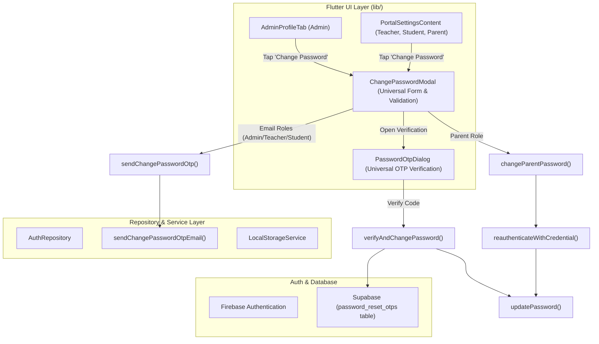

# Architecture & Design Spec: In-App Change Password Feature & Unified OTP Security

**Document Date:** November 9, 2026  
**Status:** Approved for Implementation  
**Target Tech Stack:** Pure Flutter / Dart (`lib/`), Firebase Authentication, Supabase Client & Database. *(Zero TypeScript / External Web Scripts).*

---

## 1. Overview & Business Objectives

This feature introduces a secure, role-aware, in-app **Change Password** flow accessible directly from user settings/profile across all ClassRealm user roles:
- **Admin**: Accessible from `AdminProfileTab` in the Admin Portal.
- **Teacher**: Accessible from `PortalSettingsContent` in the Teacher Settings tab.
- **Student**: Accessible from `PortalSettingsContent` in the Student Settings screen.
- **Parent**: Accessible from `PortalSettingsContent` in the Parent Settings screen.

### Core Role Separation
1. **Users with Real Email (Admin, Teacher, Student)**:
   - Protected by a 2-step verification process:
     1. Form submission: `Current Password`, `New Password`, `Confirm New Password` with live password complexity validation.
     2. 2-Factor Authentication: 6-digit OTP code dispatched to their registered email address, verified using the reusable `PasswordOtpDialog`.
2. **Users without Email (Parent)**:
   - Parent accounts use synthetic login addresses (`@classrealm.com`) with no actual email inbox.
   - Protected by **Re-authentication via Current Password**:
     - System re-authenticates the active Firebase session (`fbUser.reauthenticateWithCredential`).
     - Once current credentials are confirmed and new password meets complexity rules, the password updates directly.
     - Does **NOT** require email OTP or teacher assistance for in-app password changes.
3. **Forgot Password Distinction**:
   - **Forgot Password** occurs when the user is logged out and forgot their credentials.
     - Admin/Teacher/Student: Self-service via email OTP.
     - Parent: Teacher-assisted password reset via `TeacherParentManagementTab` (resets to default temporary password, setting status to `first_login_pending` for identity verification on login).
   - **Change Password** occurs when the user is already logged in and wishes to rotate/update their password.

---

## 2. 60-30-10 UI/UX Design System Specification

The user interface follows the strict 60-30-10 color rule and native Flutter Material/Phosphor design language:

```
┌─────────────────────────────────────────────────────────────┐
│ 60% Dominant Base: Clean Neutral Canvas                     │
│ Light Mode: #FFFFFF (Dialog Surface) / #F8FAFC (Card Base)  │
│ Dark Mode:  #111827 (Dialog Surface) / #1F2937 (Card Base)  │
├─────────────────────────────────────────────────────────────┤
│ 30% Structural Hierarchy & Form Foundation                  │
│ Light Mode: Borders #E2E8F0, Labels #475569, Fill #F1F5F9   │
│ Dark Mode:  Borders #374151, Labels #9CA3AF, Fill #263040   │
├─────────────────────────────────────────────────────────────┤
│ 10% Interactive Accent & Status Feedback                    │
│ Primary Brand Accent: ClassRealm Blue #487898 / #2563EB     │
│ Validation Success:   Forest Green #16A34A (Checkmarks)     │
│ Validation Error:     Signal Red #DC2626 (Inline Warnings)  │
└─────────────────────────────────────────────────────────────┘
```

### Strict Inline Form Validation Rules
- **No Floating Toasts / SnackBars for Field Errors**: Inline error text is rendered directly underneath the affected input field.
- **Red Border Highlighting**: Error fields receive a 1.5px border of `#DC2626`.
- **Live Complexity Checklist**:
  - Minimum 8 characters.
  - At least 1 uppercase letter (`A-Z`).
  - At least 1 lowercase letter (`a-z`).
  - At least 1 number (`0-9`).
  - Passwords match.
  - Each item displays an animated green checkmark (`#16A34A`) when satisfied.
- **Current Password != New Password Rule**:
  - An inline error displays under the New Password field if it matches the Current Password: *"New password must be different from your current password."*

---

## 3. Standardized OTP Security & Expiration Parameters

All verification codes across the application are unified to a strict **5-minute (300-second)** lifecycle:

| Parameter | Unified Standard | Target Behavior |
| :--- | :--- | :--- |
| **OTP Expiration** | `300 seconds` (5 mins) | In-app countdown timer starts at `05:00`. Challenge token in Supabase expires after 300s. |
| **Resend Cooldown** | `60 seconds` (1 min) | Resend button is locked with dynamic countdown text until 60s expires. |
| **Max Failed Attempts** | `5 attempts` | Tracks failed entries. Remaining attempts shown inline: *"Incorrect code. 3 attempts remaining."* |
| **Progressive Lockout** | `300 seconds` (5 mins) | After 5 consecutive failed entries, email is locked out locally and in database for 5 minutes. |
| **Email Text Sync** | `"5 minutes"` | All email templates state: *"This code will expire in 5 minutes."* |

---

## 4. Distinct Email Templates in `EmailService`

`lib/core/services/email_service.dart` is refactored so each OTP flow uses its own semantic subject, title, and body text while preserving the consistent card styling:

### 1. First Login Account Activation
- **Subject**: `ClassRealm - First Login Verification Code`
- **Heading**: `Activate Your Account`
- **Body**: *"Hello **[Name]**, to complete your first login and activate your account, please enter the 6-digit verification code below to confirm your new personalized password."*
- **Footer**: *"This code will expire in 5 minutes. If you did not request this, please contact the administrator immediately."*

### 2. Forgot Password Reset
- **Subject**: `ClassRealm - Password Reset Verification Code`
- **Heading**: `Reset Your Password`
- **Body**: *"Hello **[Name]**, we received a request to reset the password for your ClassRealm account. Please enter the 6-digit verification code below to proceed with setting up your new password."*
- **Footer**: *"This code will expire in 5 minutes. If you did not request this password reset, please ignore this email or contact the administrator immediately."*

### 3. In-App Change Password
- **Subject**: `ClassRealm - Change Password Security Code`
- **Heading**: `Verify Password Change`
- **Body**: *"Hello **[Name]**, you requested to change your account password from your ClassRealm portal settings. Please enter the 6-digit verification code below to authorize this update."*
- **Footer**: *"This code will expire in 5 minutes. If you did not authorize this password change from your portal, please secure your account immediately or contact your administrator."*

---

## 5. Architectural Component Design



### Affected Files and Roles
1. **`lib/core/services/email_service.dart`**:
   - Add `sendFirstLoginOtpEmail(...)`.
   - Add `sendForgotPasswordOtpEmail(...)`.
   - Add `sendChangePasswordOtpEmail(...)`.
   - Ensure all templates reflect the unified 5-minute expiry note and semantic copy.
2. **`lib/data/repositories/auth_repository.dart`**:
   - `sendChangePasswordOtp({required String email, required String recipientName})`: Generates cryptographically secure 6-digit code, saves challenge to Supabase `password_reset_otps` with `feature: 'change_password'`, and sends email via `EmailService`.
   - `verifyAndChangePassword({required String email, required String currentPassword, required String newPassword, required String otpCode})`: Verifies OTP challenge, verifies current password, and updates Firebase user credentials.
   - `changeParentPassword({required UserModel parent, required String currentPassword, required String newPassword})`: Re-authenticates Firebase user with current password, then updates password directly.
3. **`lib/shared/widgets/modals/change_password_modal.dart`**:
   - New reusable dialog component.
   - Receives current `UserModel`.
   - Handles password inputs, visibility toggles, complexity indicators, and inline validation.
   - Dynamically branches: launches `PasswordOtpDialog` for email accounts; completes directly for parents.
4. **`lib/shared/widgets/portal_settings_content.dart`**:
   - Replace the `AppModals.showUpcomingFeatureDialog` placeholder in the Change Password `ListTile` with `ChangePasswordModal.show(context)`. Remove the "Next Update" badge.
5. **`lib/features/admin/sub_features/profile/widgets/admin_profile_tab.dart`**:
   - Add a "Change Password" button in the administrator profile overview to invoke `ChangePasswordModal.show(context)`.
6. **`lib/shared/widgets/modals/password_otp_dialog.dart`**:
   - Ensure the internal initial countdown is strictly initialized to 300 seconds (5 minutes) for complete consistency.

---

## 6. Verification and Test Plan

1. **Static Analysis**:
   - Run `flutter analyze lib/core/services/email_service.dart lib/data/repositories/auth_repository.dart lib/shared/widgets/modals/change_password_modal.dart` to verify zero warnings and strict typing.
2. **Parent Flow Test**:
   - Login as Parent.
   - Navigate to Settings -> Change Password.
   - Enter wrong current password -> Verify inline red error shows *"Current password is incorrect."*
   - Enter correct current password + new password satisfying all criteria -> Verify instant password update without OTP.
3. **Email Flow Test (Teacher/Student/Admin)**:
   - Login as Teacher or Student.
   - Navigate to Settings -> Change Password.
   - Enter current & new password -> Click Continue.
   - Verify OTP email received with specific Change Password message and 5-minute expiry notice.
   - Enter valid OTP in `PasswordOtpDialog` -> Verify password updated successfully.
4. **Forgot Password Email Regression Test**:
   - Navigate to Login -> Forgot Password.
   - Request OTP for an email account.
   - Verify received email no longer contains *"To complete your first login"* and correctly displays the Forgot Password notice.
