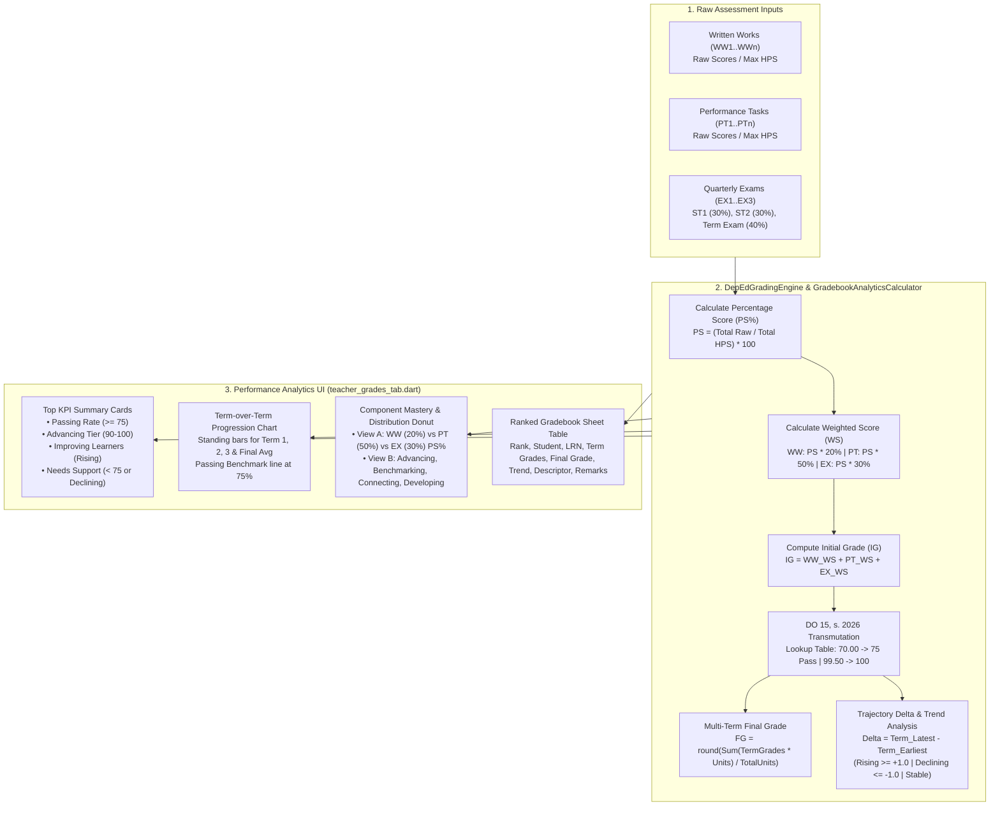

# ClassRealm • Core System Flows, Architecture & Feature Q&A Guide

**Document ID:** `CR-QA-02`  
**Primary Source Modules:**  
- `lib/core/services/sync_coordinator.dart`  
- `lib/data/datasources/local/app_database.dart`  
- `lib/core/utils/deped_grading_engine.dart`  
- `lib/features/teacher/sub_features/grading/utils/gradebook_analytics_calculator.dart`  
- `lib/features/teacher/sub_features/grading/widgets/teacher_grades_tab.dart`  
- `lib/features/teacher/sub_features/attendance/widgets/teacher_attendance_tab.dart`  
- `lib/features/teacher/sub_features/grading/widgets/teacher_gradebook_tab.dart`  
- `lib/core/widgets/auth_guard.dart`  
- `lib/routes/app_routes.dart`  

---

## System Architecture Overview

ClassRealm is an **Integrated Senior High School Management System** designed for high-availability, hybrid offline operations, and compliance with the Department of Education (DepEd) standards.

```
┌─────────────────────────────────────────────────────────────────────────────────┐
│                           CLASSREALM SYSTEM TOPOLOGY                            │
└─────────────────────────────────────────────────────────────────────────────────┘
                                         ▲
                                         │ HTTPS / WSS
                                         ▼
                     ┌───────────────────────────────────────┐
                     │          SUPABASE CLOUD POSTGRES      │
                     │  • Auth, Profiles, RLS, Storage       │
                     │  • Realtime Broadcast Channels        │
                     └───────────────────────────────────────┘
                                         ▲
                         ┌───────────────┴───────────────┐
                         ▼                               ▼
             ┌───────────────────────┐       ┌───────────────────────┐
             │      FLUTTER WEB      │       │     FLUTTER MOBILE    │
             │     (Online-First)    │       │     (Offline-First)   │
             │ • Teachers & Admin    │       │ • Native Drift SQLite │
             │ • Direct Supabase API │       │ • SyncCoordinator     │
             │ • LocalStorageService │       │ • OfflineSyncQueue    │
             └───────────────────────┘       └───────────────────────┘
                         ▲                               ▲
                         │                               │
             ┌───────────┴───────────┐       ┌───────────┴───────────┐
             │    TEACHER PORTAL     │       │   STUDENT / PARENT    │
             │ • Bulk Enrollment     │       │ • First-Login Setup   │
             │ • DepEd Gradebook     │       │ • Attendance Feed     │
             │ • Live Exam Proctor   │       │ • Grade Progress View │
             │ • RFID Cutoff Config  │       │ • Alert Notifications │
             └───────────────────────┘       └───────────────────────┘
```

---

## Section 1: Technical & Panelist Questions

### Q1: How does ClassRealm handle offline operation and prevent data loss during network dropouts?

- **Direct Summary:** On mobile/desktop platforms, ClassRealm operates an offline-first architecture powered by Drift SQLite (`AppDatabase`) and an `OfflineSyncQueue` that persists transactions locally and syncs them automatically to Supabase upon internet reconnection.
- **Technical Walkthrough:**
  1. **Ano (What):** Implemented in `lib/core/services/sync_coordinator.dart` and `lib/data/datasources/local/app_database.dart`.
  2. **Paano (How):**
     - When a mutation (e.g. marking attendance or entering a grade) is performed on mobile, the system checks `SyncCoordinator.instance.isOnline`.
     - If offline, the write is committed to local Drift SQLite tables and an entry is placed in `OfflineSyncQueue` with status `'pending'`.
     - `SyncCoordinator.startBackgroundSync()` monitors connectivity via heartbeat checks.
     - Upon network restoration, pending items transition to `'syncing'`, are transmitted to Supabase via idempotent upserts, and are marked `'synced'`.
  3. **Bakit (Why):** Philippine schools frequently encounter intermittent cellular reception and power outages. Offline-first design guarantees that morning gate attendance and classroom grade entries continue without disruption.
- **Edge Cases / Fallback:** On Flutter Web where SQLite is not natively supported (`SyncCoordinator.isLocalDbSupported == false`), the application uses `LocalStorageService` with memory caching and displays graceful offline warning banners (`SyncStatusBadge`) instead of crashing.

---

### Q2: How does the RFID / NFC attendance system process student taps and classify them into Present, Late, or Absent?

- **Direct Summary:** An ESP32 microcontroller scans student RFID cards and pushes UID packets to `rfid_pending_scans`, where ClassRealm evaluates the timestamp against teacher-configured section cutoff windows (`LocalAttendanceCutoffs`) to categorize attendance status.
- **Technical Walkthrough:**
  1. **Ano (What):** Located in `lib/features/teacher/sub_features/attendance/widgets/teacher_attendance_tab.dart` and table `rfid_pending_scans`.
  2. **Paano (How):**
     - The physical card UID is resolved to a `student_id` via `student_profiles.rfid_uid`.
     - The tap timestamp is compared against the subject offering's schedule and cutoff rules:
       - **Present:** Scan time $\le$ `startTime + gracePeriodMinutes` (default: 15 mins).
       - **Late:** `startTime + gracePeriod` $<$ Scan time $\le$ `tardyCutoffTime`.
       - **Absent:** Scan time $>$ `tardyCutoffTime` or zero scan recorded by dismissal.
     - The processed status is committed to `student_attendance` and immediately broadcasted to parent notifications.
  3. **Bakit (Why):** Automated hardware scanning eliminates manual roll-call overhead, prevents proxy attendance through physical card binding, and creates tamper-evident audit logs.
- **Edge Cases / Fallback:** If a student forgets their RFID card, teachers can manually override their attendance in the Teacher Attendance Tab with an audit note (`"Manual override by teacher"`).

---

### Q3: How is the DepEd Senior High School Grading Engine implemented, and how are final quarterly grades calculated?

- **Direct Summary:** ClassRealm implements the exact DepEd Order No. 8, s. 2015 formula, calculating Weighted Scores across Written Works (WW), Performance Tasks (PT), and Quarterly Assessment (QA), and translating the Initial Grade through the official DepEd 60–100 Transmutation Table.
- **Technical Walkthrough:**
  1. **Ano (What):** Implemented in `deped_grading_engine.dart` and `lib/features/teacher/sub_features/grading/widgets/teacher_gradebook_tab.dart`.
  2. **Paano (How):**
     - **Percentage Scores (PS):**
       $$\text{PS} = \left(\frac{\text{Learner's Total Raw Score}}{\text{Highest Possible Score}}\right) \times 100$$
     - **Weighted Scores (WS):** Based on subject track (e.g., Core Subjects: WW = 25%, PT = 50%, QA = 25%):
       $$\text{WS}_{\text{WW}} = \text{PS}_{\text{WW}} \times 0.25, \quad \text{WS}_{\text{PT}} = \text{PS}_{\text{PT}} \times 0.50, \quad \text{WS}_{\text{QA}} = \text{PS}_{\text{QA}} \times 0.25$$
     - **Initial Grade (IG):** $\text{IG} = \text{WS}_{\text{WW}} + \text{WS}_{\text{PT}} + \text{WS}_{\text{QA}}$
     - **Transmuted Quarterly Grade:** Initial grade is mapped using DepEd Order 8 Transmutation Table (e.g. 60.00–61.59 $\rightarrow$ 75, 100.00 $\rightarrow$ 100).
  3. **Bakit (Why):** Automatic compliance with DepEd standards prevents mathematical errors by teachers, standardizes grading across school departments, and ensures transparency.
- **Edge Cases / Fallback:** Once a grading period is submitted, the teacher locks the gradebook (`_isGradebookLocked = true`). Only authorized admin requests or explicit unlocks permit score alterations to prevent retroactive grade tampering.

---

### Q4: How does ClassRealm detect and prevent cheating during online examinations?

- **Direct Summary:** ClassRealm uses real-time WebSockets via Supabase Realtime channels (`teacher_proctor_channel_service.dart`) combined with browser visibility listeners to detect tab switching, fullscreen exits, and window blur events, logging infractions and auto-submitting exams on repeated violations.
- **Technical Walkthrough:**
  1. **Ano (What):** Located in `lib/features/teacher/sub_features/assessments/` and student exam assessment views.
  2. **Paano (How):**
     - On the student side, `WindowVisibilityObserver` and `BrowserUrlHelper` attach to browser blur and visibility change events (`document.visibilityState == 'hidden'`).
     - When a student switches tabs or opens another window, a WebSocket message is instantly dispatched to the teacher's proctoring channel:
       ```json
       {
         "event": "tab_switch_detected",
         "student_id": "...",
         "infraction_count": 2,
         "timestamp": "2026-11-15T08:30:12Z"
       }
       ```
     - The teacher's live dashboard flags the student in red with real-time infraction counters.
     - If infractions exceed the teacher's configured limit (e.g. 3 violations), the test is locked and auto-submitted.
  3. **Bakit (Why):** Remote and hybrid assessments require automated deterrence against search engine lookups and unmonitored browser communication.
- **Edge Cases / Fallback:** If internet connection drops during an exam, the student's answered questions are preserved in local browser session storage so no submitted work is lost when connectivity resumes.

---

### Q5: How does ClassRealm enforce security, Role-Based Access Control (RBAC), and route isolation?

- **Direct Summary:** ClassRealm enforces dual-layer security through Flutter client-side route guards (`AuthGuard`, `AppRoutes.isRouteAllowedForRole`) and Supabase server-side Row Level Security (RLS) policies that verify JWT claims on every database query.
- **Technical Walkthrough:**
  1. **Ano (What):** Implemented in `lib/core/widgets/auth_guard.dart`, `lib/routes/app_routes.dart`, and Supabase migration RLS policies.
  2. **Paano (How):**
     - **Client Navigation Guard:** When navigating to any route (e.g. `/admin/dashboard`), `AppRoutes.isRouteAllowedForRole(clean, user.role, user.accountStatus)` validates authorization:
       - Teachers cannot access `/admin/*`.
       - Students cannot access `/teacher/*`.
       - Users with `pendingFirstLogin` status are strictly trapped within `/student/first-login` or `/teacher/first-login`.
     - **Database RLS Policies:** Even if a malicious user inspects network traffic or manipulates client-side code, Supabase PostgreSQL RLS policies block unauthorized queries:
       ```sql
       CREATE POLICY "Students can only view their own grades"
       ON student_grades FOR SELECT
       USING (auth.uid() = student_id);
       ```
  3. **Bakit (Why):** Prevents privilege escalation, cross-tenant data leaks, and unauthorized access to student records in compliance with data privacy regulations.
- **Edge Cases / Fallback:** If an unauthenticated user or an unauthorized role attempts deep-linking, `AuthGuard` terminates navigation, clears invalid session tokens, and bounces the user to `/login` with an informative toast message.

---

## Section 2: User & Stakeholder Questions

### Q6: What is the First-Login Onboarding flow for newly created student and teacher accounts?

- **Direct Summary:** New accounts start with status `pendingFirstLogin` and temporary credentials; upon first login, they are automatically forced to complete security onboarding (changing password and verifying details) before accessing any dashboard.
- **Technical Walkthrough:**
  - **Account Creation:** Bulk enrollment generates a randomized temporary password (e.g. `CR#2026x!9`).
  - **Initial Login:** The user enters their email and temporary password at `/login`.
  - **Interception:** `AuthRepository` reads `account_status == AccountStatus.pendingFirstLogin`. `AuthGuard` rejects all standard dashboard routes and forces navigation to `/student/first-login`.
  - **Setup Completion:** The student sets a personal password complying with security criteria (minimum 8 characters, uppercase, number, symbol), confirms personal details, and clicks `"Complete Setup"`.
  - **Status Promotion:** The user status updates to `active` in Supabase `users`, permanently unlocking their dashboard.
- **Edge Cases / Fallback:** If a student forgets their temporary password before first login, their teacher can reset their credentials with a single click in Teacher Student Management.

---

### Q7: How does a parent monitor their child's attendance and academic performance in ClassRealm?

- **Direct Summary:** Parents link their accounts to their children via a verified Student LRN and Birthday key, gaining access to real-time RFID attendance push alerts, class schedules, and DepEd quarterly grade breakdowns.
- **Technical Walkthrough:**
  - In `ParentHomeScreen` (`lib/features/parent/screens/parent_home_screen.dart`), the parent dashboard displays:
    - **Live Attendance Status:** Shows today's entry time, tap location, and attendance badge (Present, Late, Absent).
    - **Academic Progress:** Displays quarter grades, written work scores, and performance task completion.
    - **Teacher Communication:** Allows direct contact with subject teachers through `ParentTeacherContactView`.
- **Edge Cases / Fallback:** If a parent has multiple children enrolled in the school, the Parent Portal includes a child switcher dropdown in the app bar that toggles profiles seamlessly without re-logging in.

---

### Q8: What happens when Maintenance Mode is activated by the School Administrator?

- **Direct Summary:** When the Admin toggles Maintenance Mode in Admin Settings, all non-admin users (Teachers, Students, Parents) are restricted with a maintenance splash screen, while Admins retain full access to perform database updates.
- **Technical Walkthrough:**
  - Supabase table `system_settings` maintains the boolean flag `maintenance_mode`.
  - ClassRealm subscribes to a real-time broadcast channel on `system_settings`.
  - When `maintenance_mode == true`, `AuthGuard` checks `user.role`. If the role is NOT `admin`, navigation redirects immediately to `MaintenanceScreen`.
  - As soon as Admin disables Maintenance Mode, active screens automatically reload to normal state via the Realtime listener.
- **Edge Cases / Fallback:** Critical services like ESP32 gate attendance caching continue operating locally in Drift SQLite even during maintenance mode.

---

### Q9: How does the Performance Analytics engine compute, transmute, and visualize student academic performance, DO 15 achievement tiers, and learning trajectories?

- **Direct Summary:** ClassRealm's Performance Analytics module (`teacher_grades_tab.dart`) integrates with the Electronic Gradebook and `DepEdGradingEngine` to provide real-time cohort analytics. It automatically aggregates raw scores, calculates Percentage Scores ($PS$), applies curriculum component weights ($WW\ 20\%$, $PT\ 50\%$, $EX\ 30\%$), computes Initial Grades ($IG$), applies DepEd Order No. 15, s. 2026 transmutation ($75$ passing), and classifies learners into diagnostic achievement tiers with trajectory delta tracking (`Improving`, `Stable`, `Declining`).

- **Architecture & Calculation Pipeline:**



- **Detailed Mathematical Walkthrough:**

  1. **Component Percentage Score ($PS$):**
     * **Written Works ($WW$) and Performance Tasks ($PT$):**
       $$PS = \text{round}_2\left( \frac{\sum \text{Raw Score}_i}{\sum HPS_i} \times 100 \right)$$
     * **Examinations ($EX$):** DepEd Senior High modular assessments split the exam component across Sub-Tests (ST1: 30%, ST2: 30%, Terminal Exam: 40%):
       $$\text{SubWeightedScore}_k = \text{round}_2\left( \frac{\text{Score}_k}{HPS_k} \times \text{Weight}_k \right)$$
       $$PS_{EX} = \text{round}_2\left( \frac{\sum_{k=1}^3 \text{SubWeightedScore}_k}{\sum \text{ActiveSubWeights}} \times 100 \right)$$

  2. **Weighted Score ($WS$):**
     Based on DepEd Senior High School standard weights (e.g., General Mathematics: $WW\ 20\%$, $PT\ 50\%$, $EX\ 30\%$):
     $$WS_{WW} = \text{round}_2\left( PS_{WW} \times 0.20 \right)$$
     $$WS_{PT} = \text{round}_2\left( PS_{PT} \times 0.50 \right)$$
     $$WS_{EX} = \text{round}_2\left( PS_{EX} \times 0.30 \right)$$

  3. **Initial Grade ($IG$):**
     $$\text{Initial Grade} = \text{round}_2\left( WS_{WW} + WS_{PT} + WS_{EX} \right)$$

  4. **DO 15, s. 2026 Transmutation Table:**
     Initial grades are mapped to official transmuted grades on a 60–100 scale:
     * $99.50 - 100.00 \longrightarrow 100$
     * $90.06 - 91.23 \longrightarrow 92$
     * $70.00 - 71.17 \longrightarrow 75$ *(Minimum Passing Standard)*
     * $65.34 - 69.99 \longrightarrow 74$
     * $0.00 - 4.67 \longrightarrow 60$ *(Base Floor Grade)*

  5. **Multi-Term Final Grade ($FG$):**
     For multi-quarter/term academic years:
     $$\text{Final Grade} = \text{round}\left( \frac{\sum_{t=1}^T \text{TermGrade}_t \times \text{Units}_t}{\text{TotalUnitsEarned}} \right)$$

  6. **Academic Trajectory Delta ($\Delta$) & Trend:**
     Evaluated in `GradebookAnalyticsCalculator._trendFromDelta()`:
     * **Cross-Term View:** $\Delta = \text{Grade}_{\text{latest term}} - \text{Grade}_{\text{earliest term}}$
     * **Single-Term View:** $\Delta = \text{Average}_{\text{latter tasks}} - \text{Average}_{\text{earlier tasks}}$
     * **Classification:**
       * $\Delta \ge +1.0$: `Improving` (Rising score trajectory)
       * $\Delta \le -1.0$: `Declining` (Needs teacher intervention)
       * $-1.0 < \Delta < +1.0$: `Stable` (Consistent performance)

- **UI Components Explained:**

  | UI Widget / Card | Mathematical Basis & Source | Purpose & Actionable Insight for Teachers |
  | :--- | :--- | :--- |
  | **Passing Rate Badge** | $(\text{Passed Count} \div \text{Encoded Count}) \times 100$ | Instantly alerts if the cohort meets DepEd's 75% benchmark threshold. |
  | **Advancing Tier (90–100)** | $(\text{Learners with Grade} \ge 90 \div \text{Total}) \times 100$ | Identifies high-achieving candidates for academic honors and commendations. |
  | **Improving Learners** | Count of students where $\text{Trend} == \text{GradeTrend.improving}$ | Highlights positive momentum and effective intervention response. |
  | **Needs Support** | Students where $\text{Grade} < 75$ OR $\text{Trend} == \text{GradeTrend.declining}$ | Diagnostic early-warning filter for students requiring remedial tasks or parent consultation. |
  | **Term Progression Chart** | Term averages plotted with benchmark line at $75$ | Visualizes long-term growth across quarters to identify seasonal learning dips. |
  | **Component Mastery Donut** | Mean Percentage Score ($PS\%$) per category ($WW, PT, EX$) | Pinpoints specific curricular weaknesses (e.g., strong in tasks but failing exams). |
  | **Performance Distribution Donut** | Cohort breakdown across Advancing, Benchmarking, Connecting, Developing | Provides institutional readiness metrics for accreditation and school administration. |
  | **Student Ranking Table** | Descending rank by transmuted grade with LRN and descriptors | DepEd Form 137 / Form 138-ready grading summary with one-click export. |

- **Edge Cases & Fault-Tolerance:**
  * **Zero-Encoded Assessments:** If a teacher creates activities but has not encoded scores, metrics render as pending (`—`) with zero-division protection (`encodedCount > 0 ? ... : null`).
  * **Dynamic Weight Normalization:** If a subject excludes examinations ($EX = 0$), the engine automatically recalculates weights across $WW$ and $PT$ without breaking the 100% total proportion.
  * **Synced with Gradebook:** The analytics tab uses a real-time stream; as soon as a teacher updates a cell in the Gradebook sheet, the Analytics charts, donut slices, and KPI cards update instantaneously without a page reload.
