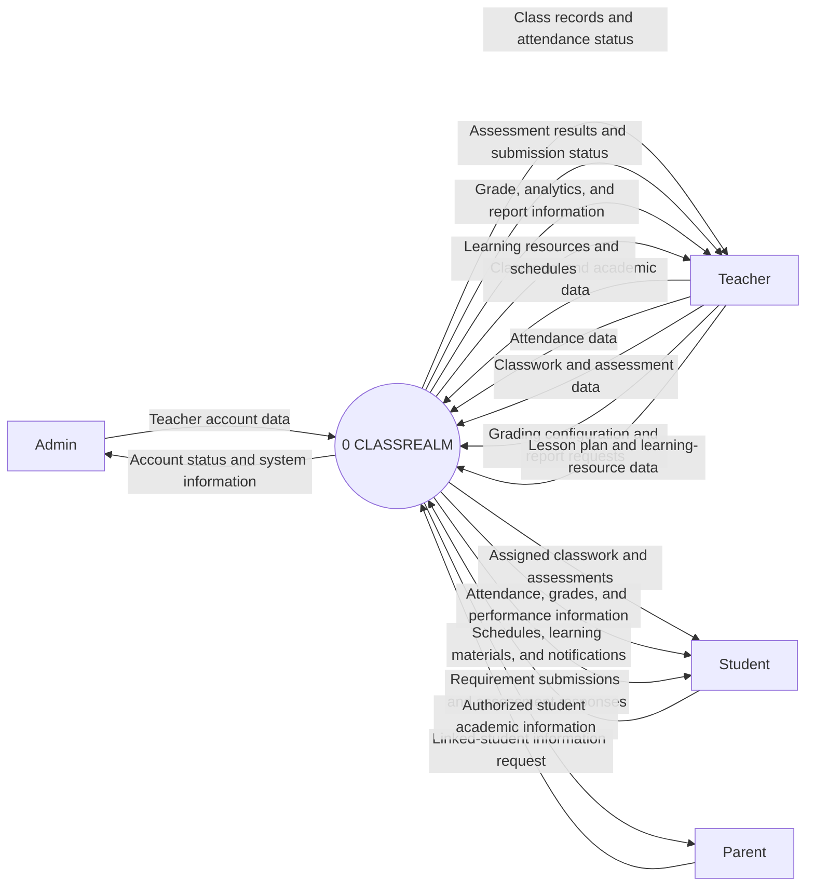
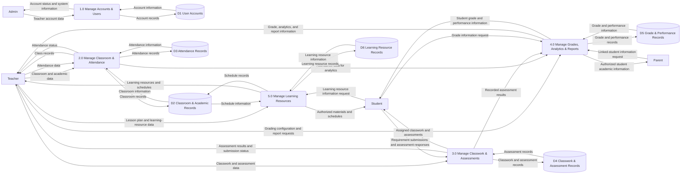
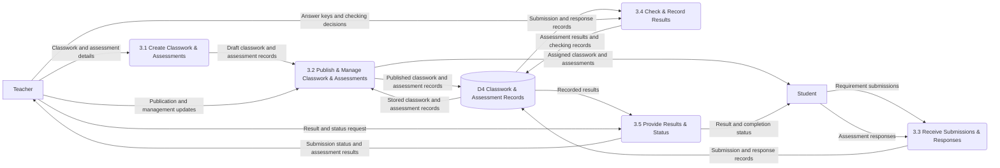

# ACTIVITY #2 - DATA FLOW DIAGRAM

## CLASSREALM

**System name:** CLASSREALM  
**Project context:** Integrated Senior High School attendance, activity and requirement tracking, teacher lesson planning, and learning materials management.

> **Notation used in the Mermaid diagrams**
>
> - Rounded rectangles represent processes.
> - Rectangles represent external entities.
> - Cylinders represent data stores.
> - Arrows represent named data or information flows.
>
> The diagrams use Gane-Sarson-style roles and labels. The diagrams are intentionally separated into readable flows instead of combining unrelated data types into one arrow.

---

# PART A - REQUIREMENTS REVIEW

## 1. Stakeholders / External Users

| Stakeholder | Role in CLASSREALM | Main activities |
|---|---|---|
| Admin | System Manager | Manage and approve teacher accounts, manage account status, and monitor system-level information. |
| Teacher | Academic User | Manage classes, students, attendance, activities and requirements, assessments, grades, reports, lesson plans, schedules, and learning materials. |
| Student | System User | View attendance, activities, requirements, assessments, grades, performance, schedules, learning materials, and notifications; submit required work. |
| Parent | System User | View authorized information related to the linked student. |

## 2. Functional Requirements

| No. | Functional requirement |
|---|---|
| FR1 | The system shall allow Admin to manage and approve teacher accounts. |
| FR2 | The system shall allow Teacher to manage classroom information, sections, students, subjects, and schedules. |
| FR3 | The system shall allow Teacher to record and manage student attendance through manual or ESP32-RFID attendance input. |
| FR4 | The system shall allow Teacher to create and manage activities, assignments, and performance tasks and allow Students to submit requirements. |
| FR5 | The system shall allow Teacher to create and manage quizzes and examinations, including answer keys for supported objective items. |
| FR6 | The system shall automatically check supported objective quiz and examination responses and record assessment results. |
| FR7 | The system shall calculate student grades using teacher-configured grading components and provide performance analytics and reports. |
| FR8 | The system shall allow Teacher to manage lesson plans, learning materials, and class schedules and allow Students to access authorized materials and schedules. |

## 3. User Stories

| No. | User story |
|---|---|
| US1 - Admin | As an Admin, I want to approve and manage teacher accounts, so that only authorized teachers can access the teacher functions. |
| US2 - Teacher | As a Teacher, I want to create and manage activities, requirements, quizzes, and examinations, so that students can complete their academic work through the system. |
| US3 - Teacher | As a Teacher, I want to record attendance, manage grades, and view reports and performance analytics, so that I can monitor student progress. |
| US4 - Student | As a Student, I want to view and submit my assigned activities and requirements, so that I can complete and track my academic work. |
| US5 - Student | As a Student, I want to take quizzes and examinations and view my results, so that I can monitor my assessment performance. |
| US6 - Parent | As a Parent, I want to view authorized information about my linked student, so that I can monitor the student's academic progress. |

---

# PART B - PROCESS MODELING

## 1. Context Diagram

The Context Diagram treats CLASSREALM as one process. It shows only the four external users and the separate information exchanged across the system boundary. No internal process or data store is shown at this level.

### Mermaid code

### Context Diagram data-flow table

| Data Flow | From | To | Description |
|---|---|---|---|
| Teacher account data | Admin | CLASSREALM | Teacher account creation, approval, update, and status information. |
| Account status and system information | CLASSREALM | Admin | Teacher account status and system-level monitoring information. |
| Classroom and academic data | Teacher | CLASSREALM | Academic years, sections, students, subjects, and schedules. |
| Attendance data | Teacher | CLASSREALM | Manual or ESP32-RFID attendance records and attendance updates. |
| Classwork and assessment data | Teacher | CLASSREALM | Activities, requirements, quizzes, examinations, answer keys, and management information. |
| Grading configuration and report requests | Teacher | CLASSREALM | Grading components, analytics requests, and report requests. |
| Lesson plan and learning-resource data | Teacher | CLASSREALM | Lesson plans and teacher-provided learning materials. |
| Class records and attendance status | CLASSREALM | Teacher | Stored classroom information and attendance status for teacher monitoring. |
| Assessment results and submission status | CLASSREALM | Teacher | Student submissions, assessment results, and completion/status information. |
| Grade, analytics, and report information | CLASSREALM | Teacher | Computed grades, performance analytics, and generated reports. |
| Learning resources and schedules | CLASSREALM | Teacher | Stored lesson plans, learning materials, and schedules. |
| Requirement submissions and assessment responses | Student | CLASSREALM | Student-submitted activities, requirements, quiz answers, and examination responses. |
| Assigned classwork and assessments | CLASSREALM | Student | Published activities, requirements, quizzes, and examinations assigned to the student. |
| Attendance, grades, and performance information | CLASSREALM | Student | The student's authorized attendance, grades, and performance information. |
| Schedules, learning materials, and notifications | CLASSREALM | Student | Authorized schedules, teacher-provided resources, and academic notifications. |
| Linked-student information request | Parent | CLASSREALM | Request for authorized information about the linked student. |
| Authorized student academic information | CLASSREALM | Parent | Authorized attendance, grades, performance, activities, requirements, schedules, and notifications. |

## 2. Level 0 DFD

Level 0 decomposes CLASSREALM into exactly five major processes. The data stores retain only information needed by the processes and are accessed through processes, not directly by external users.

### Mermaid code

### Level 0 process table

| Process No. | Process Name | Description |
|---|---|---|
| 1.0 | Manage Accounts & Users | Creates, approves, updates, and controls teacher account information and returns account status/system information to Admin. |
| 2.0 | Manage Classroom & Attendance | Maintains classroom, section, student, subject, schedule, and manual/ESP32-RFID attendance information. |
| 3.0 | Manage Classwork & Assessments | Manages activities, requirements, quizzes, examinations, submissions, responses, answer keys, checking, and assessment status/results. |
| 4.0 | Manage Grades, Analytics & Reports | Applies teacher-configured grading components, calculates grades, produces performance analytics/reports, and serves authorized academic information. |
| 5.0 | Manage Learning Resources | Organizes lesson plans, learning materials, and schedules and provides authorized resources to students and teachers. |

### Level 0 data stores

| Data Store | Name | Stores |
|---|---|---|
| D1 | User Accounts | Admin, teacher, student, and parent account information; teacher approval and account-status records; parent-student links. |
| D2 | Classroom & Academic Records | Academic years, sections, students, subjects, class assignments, and schedules used as classroom records. |
| D3 | Attendance Records | Manual attendance, ESP32-RFID attendance input, attendance history, absence status, and synchronization information. |
| D4 | Classwork & Assessment Records | Activities, requirements, deadlines, quizzes, examinations, answer keys, student submissions, assessment responses, checking records, and assessment results/status. |
| D5 | Grade & Performance Records | Grading components, computed grades, attendance/assessment/activity performance data, analytics, and report data. |
| D6 | Learning Resource Records | Lesson plans, learning materials, resource descriptions, and resource status. |

## 3. Level 1 DFD - Decomposition of 3.0 Manage Classwork & Assessments

Level 1 decomposes only process 3.0. It does not include attendance subprocesses. The five subprocesses cover creation, publication/management, receiving work, checking/recording results, and providing results/status. The external flows crossing the Level 1 boundary are the same classwork, assessment, submission/response, and result/status flows represented by process 3.0 in Level 0.

### Mermaid code

### Level 1 process table

| Process No. | Process Name | Description |
|---|---|---|
| 3.1 | Create Classwork & Assessments | Captures teacher-provided activity, requirement, quiz, examination, item, deadline, and answer-key details as draft records. |
| 3.2 | Publish & Manage Classwork & Assessments | Publishes assigned work and assessments, manages deadlines and assignment information, and updates stored classwork/assessment records. |
| 3.3 | Receive Submissions & Responses | Receives student requirement submissions, quiz responses, and examination responses and records them for processing. |
| 3.4 | Check & Record Results | Uses answer keys for supported objective items, records checking decisions/results, and retains the resulting assessment information. |
| 3.5 | Provide Results & Status | Provides teachers with submission status and assessment results and provides students with result and completion-status information. |

---

# PART C - REQUIREMENT <-> DFD MAPPING

| Requirement | DFD Process | Data Used |
|---|---|---|
| FR1 - Manage teacher accounts | 1.0 Manage Accounts & Users | User account data; teacher approval data; account-status information. |
| FR2 - Manage classroom information | 2.0 Manage Classroom & Attendance | Classroom, academic year, section, student, subject, and schedule data. |
| FR3 - Manage attendance | 2.0 Manage Classroom & Attendance | Attendance records; manual attendance input; ESP32-RFID attendance input; attendance history and status. |
| FR4 - Manage classwork and submissions | 3.0 Manage Classwork & Assessments | Classwork, activity, requirement, deadline, assigned-work, and student-submission data. |
| FR5 - Create quizzes and examinations | 3.0 Manage Classwork & Assessments | Assessment data; question/item data; answer keys; schedule and publication information. |
| FR6 - Check assessment responses | 3.0 Manage Classwork & Assessments | Student answers/responses; answer keys; checking records; assessment results. |
| FR7 - Calculate grades and reports | 4.0 Manage Grades, Analytics & Reports | Grade records; teacher-configured grading components; performance data; analytics and report data. |
| FR8 - Manage learning resources | 5.0 Manage Learning Resources | Lesson plans; learning materials; resource information; class schedules; authorized resource access data. |

---

# PART D - DFD VALIDATION CHECKLIST

| Validation item | Status | Verification |
|---|---|---|
| Context Diagram has one process only. | PASS | The only process is `0 CLASSREALM`. |
| Four external entities are present. | PASS | Admin, Teacher, Student, and Parent are the only context-level external entities. |
| Context Diagram has no data stores. | PASS | No D1-D6 store appears in the Context Diagram. |
| Level 0 has exactly five major processes. | PASS | Processes 1.0, 2.0, 3.0, 4.0, and 5.0 are shown. |
| Level 1 decomposes 3.0 Manage Classwork & Assessments. | PASS | Every Level 1 subprocess begins with 3.x and belongs to process 3.0. |
| Level 1 has exactly five subprocesses. | PASS | Processes 3.1 through 3.5 are shown. |
| Level 1 is balanced with 3.0. | PASS | Level 1 preserves the 3.0 inputs/outputs: teacher classwork/assessment data, student submissions/responses and assigned work, and teacher/student result/status information. |
| FR1-FR8 are represented. | PASS | The Requirement-to-DFD mapping assigns every requirement to a Level 0 process. |
| Data flows are information/data. | PASS | Labels use records, data, information, requests, results, status, and reports rather than button names or actions. |
| No unnecessary processes or data stores. | PASS | The model uses only the required five Level 0 processes and six information stores needed by the documented scope. |
| No direct external entity to data-store flows. | PASS | External users exchange information with processes; processes exchange information with stores. |
| No direct data-store to data-store flows. | PASS | All store-to-store movement is mediated by a process. |
| Diagrams are readable and not overcrowded. | PASS | Flows are separated by data type, labels are short, and each diagram has a focused scope. |
